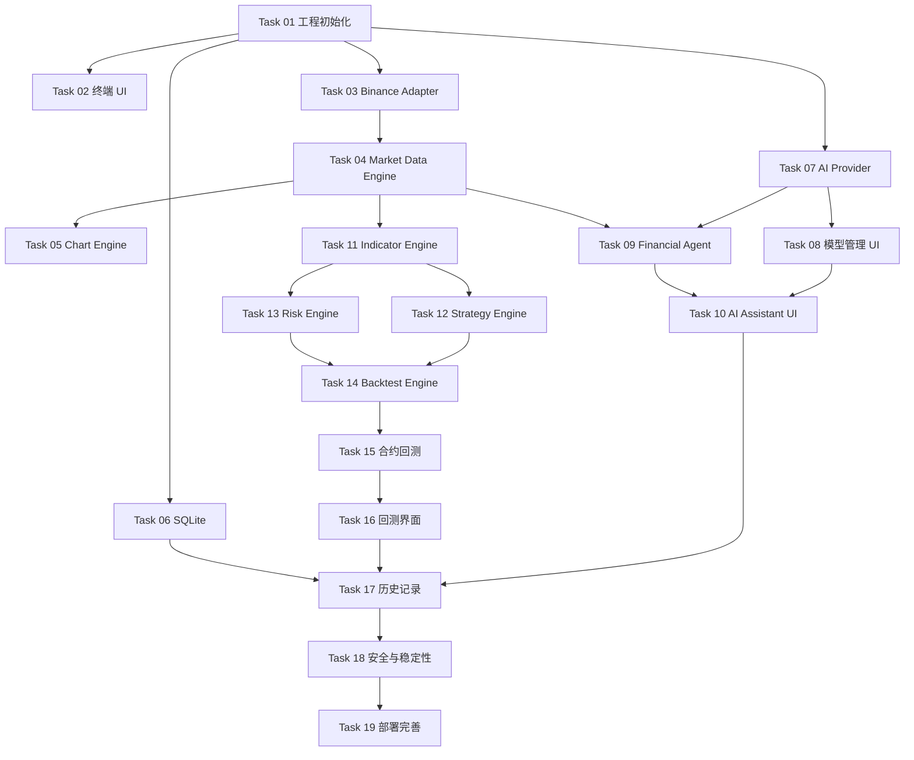

# Alpha Terminal — Development Tasks

> 开发任务与实施计划
>
> Version: 1.0.0  
> Based on: PRD v1.0.0  
> Development Mode: Solo Development  
> Architecture: Modular Monolith

---

## 1. 开发规划

### 1.1 阶段划分

| 阶段 | 开发目标 | 预估工期 | 优先级 |
|---|---|---:|---|
| Phase 1 | 实时行情终端 | 10–15 天 | P0 |
| Phase 2 | AI 模型管理与 Agent | 7–10 天 | P1 |
| Phase 3 | 技术分析与策略引擎 | 5–8 天 | P1 |
| Phase 4 | 历史回测引擎 | 10–15 天 | P1 |
| Phase 5 | 系统完善与安全部署 | 5–8 天 | P2 |

以上为单人开发的初步估算，不包含复杂高级图表和长期性能优化。

### 1.2 开发原则

- 优先保证核心业务链路可运行。
- 先建立统一数据类型，再开发具体业务模块。
- 每个模块保持独立边界。
- 优先完成 Binance 行情接入。
- 前后端并行开发，使用统一接口契约。
- 每个 Task 必须有明确验收条件。
- 不提前引入当前阶段用不到的基础设施。

### 1.3 优先级说明

| 优先级 | 含义 |
|---|---|
| P0 | 当前阶段必须完成 |
| P1 | 当前阶段重要功能 |
| P2 | 后续迭代 |
| P3 | 暂不安排 |

---

# Phase 1 — 实时行情终端

目标：完成一个可以稳定运行的真实行情终端。

暂不开发 AI、策略和回测功能。

预计工期：10–15 个工作日。

## Task 01 — 工程初始化

<badge> P0 </badge>

预计：1 天

### 开发内容

- [ ] 初始化 pnpm Monorepo。
- [ ] 配置 pnpm-workspace.yaml。
- [ ] 集成 Turborepo。
- [ ] 创建 React + Vite 前端应用。
- [ ] 创建 NestJS 后端应用。
- [ ] 配置 TypeScript。
- [ ] 配置 ESLint。
- [ ] 配置 Prettier。
- [ ] 配置 Vitest。
- [ ] 配置环境变量管理。
- [ ] 配置统一日志。
- [ ] 配置开发启动脚本。
- [ ] 建立基础共享 Package。

### 验收标准

- [ ] `pnpm install` 正常。
- [ ] `pnpm dev` 同时启动 Web 和 Server。
- [ ] 前端可以正常访问后端 API。
- [ ] Package 之间可以正常引用。
- [ ] TypeScript 类型检查正常。
- [ ] 基础测试可以运行。

---

## Task 02 — 终端 UI

<badge> P0 </badge>

预计：1–2 天

### 开发内容

- [ ] 建立深色金融终端主题。
- [ ] 实现顶部导航栏。
- [ ] 实现左侧自选列表。
- [ ] 实现中央 K 线图表区域。
- [ ] 实现右侧 AI 面板占位。
- [ ] 实现底部订单簿区域。
- [ ] 实现底部实时成交区域。
- [ ] 实现交易对切换入口。
- [ ] 实现市场类型切换入口。
- [ ] 实现 K 线周期切换入口。
- [ ] 实现面板宽度调整。
- [ ] 实现基础响应式布局。

### 验收标准

- [ ] 整体布局完整。
- [ ] 不同面板可以正常显示。
- [ ] 面板尺寸调整正常。
- [ ] UI 组件具有统一的设计规范。
- [ ] 为后续真实行情和 AI 功能预留扩展区域。

说明：本阶段优先完成布局和交互骨架，不花费过多时间制作复杂视觉效果。

---

## Task 03 — Exchange Adapter：Binance

<badge> P0 </badge>

预计：2–3 天

### 开发内容

- [ ] 定义统一 ExchangeAdapter 接口。
- [ ] 定义 ExchangeInfo 类型。
- [ ] 定义 Ticker 类型。
- [ ] 定义 Kline 类型。
- [ ] 定义 Trade 类型。
- [ ] 定义 OrderBook 类型。
- [ ] 接入 Binance REST API。
- [ ] 获取交易所交易品种信息。
- [ ] 获取实时 Ticker。
- [ ] 获取历史 K 线。
- [ ] 接入 Binance WebSocket。
- [ ] 订阅实时 K 线。
- [ ] 订阅实时成交。
- [ ] 获取订单簿 Snapshot。
- [ ] 实现 WebSocket 连接管理。
- [ ] 实现自动重连。
- [ ] 实现订阅和取消订阅。
- [ ] 实现异常处理和限频控制。

### 验收标准

- [ ] 可以获取 Binance 现货交易品种。
- [ ] 可以获取 Binance USDT 永续交易品种。
- [ ] 可以正常获取历史 K 线。
- [ ] 可以订阅实时 K 线。
- [ ] 可以订阅实时成交。
- [ ] 断开网络后可以自动恢复连接。
- [ ] 交易对切换后旧订阅正确释放。
- [ ] 不存在明显重复和乱序行情问题。

---

## Task 04 — Market Data Engine

<badge> P0 </badge>

预计：2 天

### 开发内容

- [ ] 定义统一 MarketType。
- [ ] 定义统一 MarketSymbol。
- [ ] 定义统一 MarketEvent。
- [ ] 建立行情订阅管理。
- [ ] 建立实时行情缓存。
- [ ] 建立历史 K 线缓存。
- [ ] 实现历史与实时数据合并。
- [ ] 实现 K 线去重。
- [ ] 实现 K 线排序。
- [ ] 实现行情缺失检测。
- [ ] 实现历史数据补齐。
- [ ] 实现交易对切换。
- [ ] 实现周期切换。
- [ ] 实现事件发布机制。

### 验收标准

- [ ] 不同交易所行情可以映射到统一数据结构。
- [ ] 现货和永续行情可以独立管理。
- [ ] 历史和实时 K 线可以正确衔接。
- [ ] 重复行情不会产生重复 K 线。
- [ ] 乱序行情可以正确处理。
- [ ] 缺失行情可以通过 REST 补齐。
- [ ] 订阅释放后不再收到旧交易对的数据。

---

## Task 05 — Chart Engine

<badge> P0 </badge>

预计：2–3 天

### 开发内容

- [ ] 安装 TradingView Lightweight Charts。
- [ ] 创建独立 chart-engine Package。
- [ ] 封装图表初始化逻辑。
- [ ] 实现 K 线 Series。
- [ ] 实现成交量 Series。
- [ ] 实现历史 K 线 setData。
- [ ] 实现实时 K 线 update。
- [ ] 实现图表缩放。
- [ ] 实现图表拖拽。
- [ ] 实现十字光标。
- [ ] 实现周期切换。
- [ ] 实现交易对切换。
- [ ] 实现历史数据向前加载。
- [ ] 实现 MA 指标。
- [ ] 实现 EMA 指标。
- [ ] 实现 MACD 指标。
- [ ] 实现 RSI 指标。
- [ ] 实现图表主题。
- [ ] 实现组件卸载和资源清理。

### 性能要求

- Chart 实例应稳定持有，避免 React 重渲染时重复创建。
- 历史数据使用 setData。
- 实时数据使用 update。
- 同一时间戳的数据更新同一根 K 线。
- 高频消息通过 requestAnimationFrame 合并 UI 更新。
- 指标计算与图表渲染解耦。
- 正确清理 WebSocket 订阅。

### 验收标准

- [ ] 可以正常显示历史 K 线。
- [ ] 可以正常更新实时 K 线。
- [ ] 可以显示成交量。
- [ ] 可以切换 MA、EMA、MACD、RSI。
- [ ] 可以正常缩放和拖拽。
- [ ] 可以加载更早的历史行情。
- [ ] 交易对切换后图表数据正确。
- [ ] 周期切换后图表数据正确。
- [ ] 不存在明显重复渲染或内存泄漏。

---

## Task 06 — SQLite 数据持久化

<badge> P0 </badge>

预计：1 天

### 开发内容

- [ ] 安装 SQLite。
- [ ] 集成 Drizzle ORM。
- [ ] 配置数据库文件目录。
- [ ] 创建数据库初始化逻辑。
- [ ] 创建数据库 Migration。
- [ ] 创建 ExchangeConfig 表。
- [ ] 创建 ModelConfig 表。
- [ ] 创建 Watchlist 表。
- [ ] 实现 Repository 基础封装。
- [ ] 实现自选列表增删改查。
- [ ] 实现交易所配置持久化。
- [ ] 实现模型配置持久化。

### 验收标准

- [ ] 数据库可以正常初始化。
- [ ] Migration 可以正常执行。
- [ ] 自选列表可以持久化。
- [ ] 交易所配置可以持久化。
- [ ] 应用重启后配置不会丢失。
- [ ] 数据库访问逻辑与业务逻辑分离。

说明：本阶段不将所有实时行情写入 SQLite。

---

## Phase 1 — 最终验收

- [ ] Monorepo 前后端正常启动。
- [ ] Binance 现货 BTC/USDT 历史 K 线。
- [ ] Binance USDT 永续 BTCUSDT 历史 K 线。
- [ ] WebSocket 实时行情。
- [ ] K 线增量更新而非全量刷新。
- [ ] 交易对和周期切换。
- [ ] 历史数据加载。
- [ ] 成交量和基础指标。
- [ ] WebSocket 自动重连。
- [ ] 检测并补齐行情缺口。
- [ ] 现货和永续分别管理订阅。
- [ ] 连续运行两小时无明显内存增长或数据异常。
- [ ] SQLite 自选和配置持久化。

**Phase 1 完成标准：能够稳定运行一个真实的 Binance 行情终端。**

---

# Phase 2 — AI 模型管理与 Financial Agent

目标：实现用户自主配置 AI 模型，并通过自然语言调用金融分析工具。

预计：7–10 天。

## Task 07 — AI Provider 基础设施

- [ ] 创建 ai-core Package。
- [ ] 创建 ai-providers Package。
- [ ] 定义统一 AI Provider 接口。
- [ ] 接入 OpenAI Compatible。
- [ ] 接入 Anthropic。
- [ ] 实现 API Key 管理。
- [ ] 实现 Base URL 配置。
- [ ] 实现 Model ID 配置。
- [ ] 实现模型连接测试。
- [ ] 实现流式输出。
- [ ] 实现超时和错误处理。
- [ ] 实现 Tool Calling 能力检测。

验收：

- [ ] 可以新增和管理模型。
- [ ] 可以测试模型连接。
- [ ] 可以正常进行流式对话。
- [ ] 可以切换不同模型。
- [ ] 不同 Provider 的差异得到正确处理。

## Task 08 — AI 模型管理界面

- [ ] 模型列表。
- [ ] 新增模型。
- [ ] 编辑模型。
- [ ] 删除模型。
- [ ] 默认模型设置。
- [ ] API Key 安全输入。
- [ ] 模型连接测试。
- [ ] 模型参数配置。
- [ ] 模型能力展示。

验收：

- [ ] 模型配置可以持久化。
- [ ] API Key 不以明文形式存入前端存储。
- [ ] 用户可以自由切换模型。

## Task 09 — Financial Agent

- [ ] 创建 Agent 基础结构。
- [ ] 实现 Tool Registry。
- [ ] 实现工具注册机制。
- [ ] 实现工具参数校验。
- [ ] 实现工具执行结果标准化。
- [ ] 实现 Agent 工具调用循环。
- [ ] 实现最大调用次数限制。
- [ ] 实现异常恢复。
- [ ] 实现对话上下文管理。
- [ ] 实现流式消息输出。

首批工具：

- [ ] get_ticker
- [ ] get_klines
- [ ] calculate_rsi
- [ ] calculate_macd
- [ ] analyze_trend
- [ ] find_support_resistance
- [ ] calculate_rr
- [ ] calculate_position_size
- [ ] calculate_max_loss

验收：

- [ ] AI 可以根据自然语言选择工具。
- [ ] AI 可以获取真实市场数据。
- [ ] AI 可以调用技术指标工具。
- [ ] AI 可以调用风险计算工具。
- [ ] AI 可以组织多工具分析结果。
- [ ] 数据不足时可以明确说明。
- [ ] AI 不会在缺乏依据时强行给出交易信号。

## Task 10 — AI Assistant UI

- [ ] 实现 AI 对话面板。
- [ ] 实现消息列表。
- [ ] 实现用户消息输入。
- [ ] 实现流式消息展示。
- [ ] 实现 Markdown 渲染。
- [ ] 实现代码和数据展示。
- [ ] 实现工具调用状态。
- [ ] 实现对话历史。
- [ ] 实现模型切换。
- [ ] 实现分析结果卡片。
- [ ] 实现错误和重试状态。

验收：

- [ ] 用户可以自然语言提问。
- [ ] AI 可以流式回答。
- [ ] 工具调用过程可追踪。
- [ ] 对话可以持久化。
- [ ] 分析结果可以在终端中展示。

---

# Phase 3 — 技术分析与策略引擎

目标：建立独立于 AI 的技术指标、策略和风险计算能力。

预计：5–8 天。

## Task 11 — Indicator Engine

- [ ] 创建 indicator-engine Package。
- [ ] 实现 MA。
- [ ] 实现 EMA。
- [ ] 实现 MACD。
- [ ] 实现 RSI。
- [ ] 实现 Bollinger Bands。
- [ ] 实现 ATR。
- [ ] 统一指标输入输出格式。
- [ ] 增加指标单元测试。
- [ ] 验证边界数据和异常数据。

验收：

- [ ] 指标结果符合预期。
- [ ] 可以独立运行。
- [ ] 不依赖 React、NestJS 和 AI。
- [ ] 可以被图表和策略模块复用。

## Task 12 — Strategy Engine

- [ ] 创建 strategy-engine Package。
- [ ] 定义策略配置结构。
- [ ] 定义入场条件。
- [ ] 定义出场条件。
- [ ] 定义止损和止盈规则。
- [ ] 实现条件组合。
- [ ] 实现策略信号生成。
- [ ] 实现策略管理 API。
- [ ] 实现策略配置持久化。

验收：

- [ ] 可以创建和管理策略。
- [ ] 策略能够独立运行。
- [ ] 策略能够输出标准化信号。
- [ ] 策略逻辑不依赖 AI。

## Task 13 — Risk Engine

- [ ] 创建 risk-engine Package。
- [ ] 实现仓位计算。
- [ ] 实现最大亏损计算。
- [ ] 实现风险收益比计算。
- [ ] 实现杠杆风险计算。
- [ ] 实现保证金计算。
- [ ] 实现现货风险规则。
- [ ] 实现永续合约风险规则。

验收：

- [ ] 风险计算结果具有确定性。
- [ ] 现货和永续采用不同的计算规则。
- [ ] AI 可以调用 Risk Engine。
- [ ] 计算过程和参数可追溯。

---

# Phase 4 — 历史回测引擎

目标：通过历史行情验证策略的有效性。

预计：10–15 天。

## Task 14 — Backtest Engine

- [ ] 创建 backtest-engine Package。
- [ ] 定义回测任务配置。
- [ ] 定义回测执行结果。
- [ ] 实现历史行情读取。
- [ ] 实现历史数据时间推进。
- [ ] 实现策略信号接入。
- [ ] 实现模拟订单。
- [ ] 实现开仓逻辑。
- [ ] 实现平仓逻辑。
- [ ] 实现手续费计算。
- [ ] 实现滑点计算。
- [ ] 实现仓位管理。
- [ ] 实现资金变化计算。
- [ ] 实现交易记录。
- [ ] 实现回测结果持久化。

## Task 15 — 合约回测扩展

- [ ] 实现杠杆计算。
- [ ] 实现保证金计算。
- [ ] 实现资金费率。
- [ ] 实现强平风险模拟。
- [ ] 实现合约盈亏计算。
- [ ] 区分逐仓和全仓规则（如纳入支持范围）。

## Task 16 — 回测分析界面

- [ ] 回测参数配置。
- [ ] 回测任务列表。
- [ ] 回测执行状态。
- [ ] 收益曲线。
- [ ] 最大回撤展示。
- [ ] 胜率和盈亏比。
- [ ] 交易记录列表。
- [ ] 单笔交易详情。
- [ ] 回测结果导出。
- [ ] 样本内和样本外对比。

### 回测验收标准

- [ ] 可以对指定策略执行历史回测。
- [ ] 手续费和滑点计算正确。
- [ ] 永续合约考虑资金费率。
- [ ] 避免未来数据泄漏。
- [ ] 结果能够重复计算。
- [ ] 可以查看每笔模拟交易。
- [ ] 可以查看收益和风险指标。

---

# Phase 5 — 系统完善与安全部署

目标：完善本地产品体验，为未来云端部署做准备。

预计：5–8 天。

## Task 17 — 历史记录

- [ ] AI 对话历史。
- [ ] AI 分析记录。
- [ ] 策略历史。
- [ ] 回测历史。
- [ ] 分析结果详情。
- [ ] 历史数据快照。
- [ ] 分析记录导出。

## Task 18 — 安全与稳定性

- [ ] API Key 加密存储。
- [ ] 本地服务监听地址限制。
- [ ] CORS 限制。
- [ ] 本地会话 Token。
- [ ] 敏感信息日志脱敏。
- [ ] WebSocket 异常处理。
- [ ] 后台任务异常恢复。
- [ ] 长时间运行内存检测。
- [ ] 数据备份与恢复。

## Task 19 — 部署与产品完善

- [ ] 统一本地启动脚本。
- [ ] 本地数据目录配置。
- [ ] 数据导入和导出。
- [ ] 日志查看。
- [ ] 错误提示和诊断。
- [ ] 生产构建。
- [ ] 部署文档。
- [ ] 用户使用文档。
- [ ] Electron 包装可行性评估。

---

## 2. 任务依赖关系

说明：

- UI、Binance Adapter 和 SQLite 可以在工程初始化后并行开发。
- Market Data Engine 依赖交易所 Adapter。
- Chart Engine 依赖 Market Data Engine。
- AI Agent 依赖 AI Provider 和金融工具。
- Backtest Engine 依赖 Strategy、Risk 和历史行情数据。
- Phase 2 及之后的模块不需要推翻 Phase 1 的基础架构。

---

## 3. 建议开发顺序

为了尽快得到可运行成果，推荐按照以下顺序推进：

| 顺序 | Task | 说明 |
|---|---|---|
| 1 | Task 01 | 先建立 Monorepo |
| 2 | Task 02 | 搭建终端 UI |
| 3 | Task 03 | 获取 Binance 真实行情 |
| 4 | Task 04 | 建立统一行情数据层 |
| 5 | Task 05 | 接入 K 线图表 |
| 6 | Task 06 | 持久化配置 |
| 7 | Task 07–10 | AI 接入与 Agent |
| 8 | Task 11–13 | 指标、策略与风险 |
| 9 | Task 14–16 | 回测 |
| 10 | Task 17–19 | 安全与产品完善 |

---

## 4. 当前开发状态

### Phase 1 — 实时行情终端

- [ ] Task 01 — 工程初始化
- [ ] Task 02 — 终端 UI
- [ ] Task 03 — Binance Adapter
- [ ] Task 04 — Market Data Engine
- [ ] Task 05 — Chart Engine
- [ ] Task 06 — SQLite

### Phase 2 — AI 模型与 Agent

- [ ] Task 07 — AI Provider
- [ ] Task 08 — 模型管理 UI
- [ ] Task 09 — Financial Agent
- [ ] Task 10 — AI Assistant UI

### Phase 3 — 策略与风险

- [ ] Task 11 — Indicator Engine
- [ ] Task 12 — Strategy Engine
- [ ] Task 13 — Risk Engine

### Phase 4 — 回测

- [ ] Task 14 — Backtest Engine
- [ ] Task 15 — 合约回测扩展
- [ ] Task 16 — 回测分析界面

### Phase 5 — 产品完善

- [ ] Task 17 — 历史记录
- [ ] Task 18 — 安全与稳定性
- [ ] Task 19 — 部署与产品完善

---

## 5. 开发约束

1. 不提前引入 Redis、PostgreSQL、TimescaleDB 和 BullMQ。
2. 不在前端直接管理交易所 WebSocket 连接，行情统一经过后端 Market Data Engine。
3. 不在 React 组件中实现交易所数据处理逻辑。
4. 不在 AI 模块中实现指标和风险计算。
5. 不在回测引擎中依赖 AI。
6. 不将高频实时行情全部写入 SQLite。
7. 不允许 AI 自动执行真实交易。
8. 不允许使用未经确认的行情数据生成交易建议。
9. 核心数据处理逻辑必须有单元测试。
10. 所有回测结果必须保留必要的参数和数据版本信息。

---

## 6. 阶段完成定义（Definition of Done）

每个 Task 完成前需要满足：

- [ ] 功能符合任务描述。
- [ ] TypeScript 类型检查通过。
- [ ] 核心逻辑有必要的测试。
- [ ] 不存在明显的运行时错误。
- [ ] 关键异常情况得到处理。
- [ ] 模块边界没有被破坏。
- [ ] 相关文档已经更新。
- [ ] 可以在本地正常运行和验证。

**开发优先级：先实现稳定的数据链路，再实现 AI 能力，最后实现策略回测。**